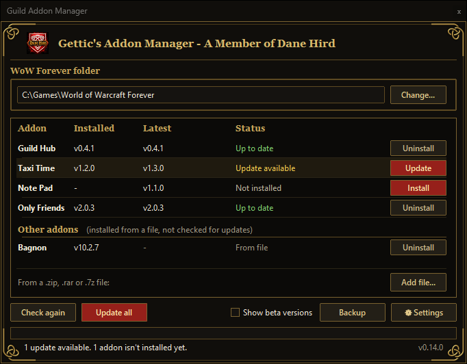
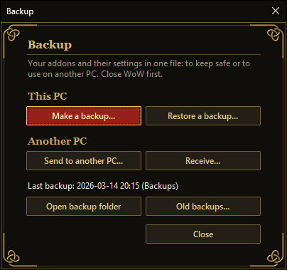
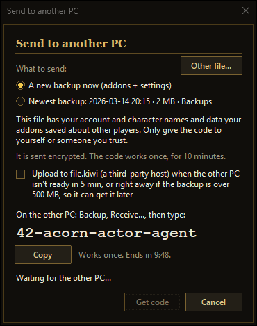
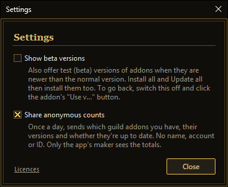

# Guild Addon Manager

An app for Windows and Linux (beta, for SteamOS / Steam Deck) that installs and updates the guild's addons for WoW Forever with one click. On Windows it is one file, `AddonManager.exe`. On Linux it is one file too, `AddonManager-x86_64.AppImage`. You don't need to install anything else. It opens in about a second. It has its own icon (the guild logo) on the file, in the window, on the taskbar and in Alt+Tab.



It is not an in-game addon. It downloads the guild's addons and puts them into your WoW Forever `Interface\AddOns` folder.

Current version: v0.17.0

## Get it

Download the latest version here: https://github.com/gettic/AddonManager/releases/latest/download/AddonManager.exe

This link always gives you the newest `AddonManager.exe`.

**Linux (beta):** https://github.com/gettic/AddonManager/releases/latest/download/AddonManager-x86_64.AppImage

It stays "beta" until it has been tested on a real Steam Deck.

If you have an older Linux version (v0.9.1 or older), it can't update itself to this file. Download the AppImage once by hand. After that it updates itself.

## First start

Windows may show "Windows protected your PC" the first times, because the app isn't signed. This is normal. Click **More info**, then **Run anyway**.

## Linux (beta) and Steam Deck

Made for Desktop Mode.

1. Switch the Steam Deck to Desktop Mode and download `AddonManager-x86_64.AppImage`. Keep it in your home folder (for example `~/Applications`), not inside the game folder.
2. Right-click it, choose **Properties**, then **Permissions**, and tick **Is executable** (it may say "Allow executing file as program"). You only do this once, because the browser removes this setting.
3. Double-click it. It updates itself like the Windows version, and the file stays executable after updates.

The release also has `AddonManager.png` as its own small file. Use it as the picture for a desktop shortcut or a Steam "Non-Steam Game".

It finds WoW Forever installed through Battle.net with Proton (as a non-Steam game), Lutris, Heroic, Bottles or Wine, also on the SD card. If it can't, click **Choose folder** and pick the Battle.net Proton folder (`~/.local/share/Steam/steamapps/compatdata/<number>`; hidden folders are shown) or the `World of Warcraft` folder inside it.

For Game Mode, right-click the AppImage and choose **Add to Steam** (or in Steam: **Add a Non-Steam Game**, then **Browse**). This should work, but it is untested on a Deck. Don't force Proton on it: it is a Linux program.

Settings and log are in `~/.config/AddonManager`. On Linux the **Settings** button has no gear symbol, and the main-window bottom row has a shorter label: a **Betas** checkbox (the **Settings** window still says **Show beta versions**).

The app finds the system's security certificates by itself, so Send / Receive, update checks and the addon list work on SteamOS. Links and folders open with the system's own tools. If the certificates still can't be checked, the app says so and asks you to check your date and time, instead of "check your internet". This also goes for addon downloads and the app's own update.

Blizzard doesn't officially support playing WoW on Linux, SteamOS or through Proton/Wine. The Addon Manager only installs addon files. Whether the game runs there is up to Proton/Wine.

## How to use it

1. Open `AddonManager.exe`. It looks for your WoW Forever folder by itself (for example `World of Warcraft\_forever_`). It only picks a real WoW Forever folder, never Beta, PTR, Classic or Retail. If it can't find it, click **Choose folder** and pick the folder where WoW Forever is installed.
2. The list shows each guild addon with the version you have and the latest version (for example v1.2.3). The guild's addons are listed in the guild's order, Guild Hub first. The window is dark with gold lines and knot corners, and the title "Gettic's Addon Manager - A Member of Dane Hird" is at the top. The Install and Update buttons are red, and a row with an update has a light band. With many addons the list scrolls (mouse wheel or the thin gold bar) while the column headers and the buttons at the bottom stay in place. Every other window has the same look. It fits 100 % and 150 % display scaling and works on Linux. The app's own version is shown at the bottom right. When the app opens, the list shows at once with the versions it knew last time, while it checks for updates. The buttons stay greyed out until the check is done (point at one to see why). After the check, the bottom line sums up, for example "All addons are up to date." or "1 update available." The window opens where and as big as you left it. The status is colour-coded:

   | Status | Colour |
   | --- | --- |
   | Update available | gold |
   | Not installed | light grey |
   | Up to date | green |
   | Failed install | red "Failed" block |

   The title bar is dark too on Windows 10 (20H1 or newer) and Windows 11. The **Choose folder** window follows your Windows light or dark setting.
3. Click **Install** or **Update** next to an addon, or the big button at the bottom to do every addon that needs it. It says **Update all** when an installed addon has an update, otherwise **Install all**. It is greyed out when there is nothing to do.
4. If the status says "Installed (version unknown)", the button says **Reinstall**.
5. To use a different WoW Forever folder, click **Change...**. The folder path at the top can be selected and copied (Ctrl+C, or right-click and Copy). Right-click it to also **Open AddOns folder** or **Open log folder** (handy when asking for help). On Steam Deck, press and hold instead of right-click (also on an addon's name).
6. Click **Check again** (point at it to see the tooltip; or press **F5** or Ctrl+R) to reload the list, for example after your internet came back.

When the app asks a question, **Enter** means Yes only if nothing is removed, deleted or overwritten. For Uninstall, Delete and Restore questions you have to click.

If the app had saved the folder of another version (for example Retail), it switches to WoW Forever and tells you. If you pick another version's folder yourself, the app uses it but shows a warning.

If WoW is running, the app warns you. You can still install. Afterwards type `/reload` in the game, or restart it, to use the new versions.

If something fails, the app tells you in plain words and nothing is half-installed: your old version stays. Error messages say where the details are: right-click the folder path and choose **Open log folder**.

## Updating the app itself

When a newer version of Addon Manager is out, a bar appears with **Update now**, **Later** and a **What's new** link.

- **Update now** downloads the new `AddonManager.exe` (on Linux, `AddonManager-x86_64.AppImage`) from the AddonManager releases, replaces the old one and restarts the app. On Windows the new icon shows right away. If the new version doesn't start, the old one comes back. The leftover `AddonManager.exe.old` is removed automatically (an old one from an earlier update goes away the next time you open the app).
- **Later** hides the bar. **Check again** (or F5) looks for a newer Addon Manager too and brings the bar back.

Keep `AddonManager.exe` (or the AppImage) in a normal folder, such as Desktop, Downloads or Documents. If it is inside your WoW folder, or in a folder the app can't write to, it can't replace itself. The bar then shows the download page instead, and you download the new version by hand.

## Beta versions

A beta is a test version of an addon. It may have bugs. The checkbox **Show beta versions** (at the bottom of the main window, next to **Backup** and **Settings**, and also in the **Settings** window; both always match) is off by default, and the app remembers your choice.

- When it is on, an addon's newest beta is offered if it is newer than its normal version. It is shown as "v1.2.0 (beta)".
- Turning it off does not remove the beta. You keep it until a newer normal version comes out.
- To go back sooner: with the checkbox off, an addon whose installed beta is newer than its normal version says "Beta installed" and has a **Use vX** button. Click it and confirm "Go back to the normal version?". Your addon settings are kept.
- **Install all** and **Update all** never go back by itself.
- If an addon has no normal version yet, the row just says "Beta installed".
- The Addon Manager's own updates always use normal versions.

## Uninstalling an addon

Each row has one button. When the addon is installed and up to date, it says **Uninstall**. Click it. If the row shows **Update** (or another button), right-click the row and choose **Uninstall <name>...**. After you say yes:

- The addon's folder goes to the Recycle Bin (on Linux: the Trash). You can put it back from there.
- If the drive has no Recycle Bin or Trash, the question says the folder will be deleted for good.
- Your settings for it in the game (the `WTF` folder) are kept.
- The row then says **Uninstalled**. **Install all** and **Update all** skip it. Its own **Install** button brings it back.
- If WoW is open and a file is in use, nothing is removed and a message tells you.
- If a delete for good can only be done partly, the app says so and finishes it the next time it starts. WoW won't load what is left.
- If another addon needs it, the question tells you.

Only the guild's addons and the ones you added from a file can be uninstalled, never other addons.

## Backup and restore

Click **Backup** (bottom row, left of **Settings**).



The **Backup** window has **Make a backup...** and **Restore a backup...** (This PC), and **Send to another PC...** and **Receive...** (Another PC). It also shows "Last backup: <date> (<place>)", and once a backup is found, an **Open backup folder** button and an **Old backups...** button. A greyed button says why in a tooltip.

You can make a backup (and send a new one) while WoW is open. Your settings are the ones from your last `/reload` or logout, so type `/reload` in WoW first to include today's changes. A settings file WoW is writing at that very moment is left out, and the "Backup saved" line names it. **Restore a backup...** still needs WoW closed.

A progress bar with a percentage shows while a backup is made (also when **Send to another PC...** makes a new one) and while restoring. **Cancel** stops a backup being made; nothing is saved. A restore can't be stopped half-way.

**Make a backup...** saves your addons and their settings (saved variables, key bindings and macros) in one file called `AddonManager backup <date>.zip`.

- It goes to `Documents\AddonManager backups` unless you click **Change...** and pick another folder.
- If a cloud folder is on the PC, a button saves it there. Documents stays the default. The app only looks for the synced folder, it never logs in to a cloud.

  | System | Cloud places it looks for |
  | --- | --- |
  | Windows | OneDrive, Google Drive (also on its own drive letter), iCloud Drive, Dropbox, MEGA, pCloud, Box, Proton Drive, Nextcloud, Sync.com |
  | Linux | Dropbox, MEGA, pCloud (while it is running), Nextcloud |
- You can untick the addons or the settings.
- The backup remembers your **Other addons** (the ones added with **Add file...**). Restore it on another PC, or after a reinstall, and they show under **Other addons** again right away.
- **Spoken** (the AI voice-over addon, any folder starting with "Spoken") is big and holds almost no settings. The first time a backup would hold it, the app asks once: **Leave them out** or **Keep them**, with the size. Your answer is remembered. To change it, use the tick "Leave out Spoken (AI voice-over addon)" in the Make a backup window (shown only when Spoken is installed). Only the addon folders are left out. Their settings are still saved.
- The file holds your account and character names. Don't share it.
- `Config.wtf` and the saved chat history (also of chat addons like Elephant or WIM) are never included.
- A backup folder can't be inside the WoW folder. The app asks for another one.

**Restore a backup...** (for example on a new PC): a list of **Backups found** opens (Documents, your backup folder and the cloud folders), newest first with date, size and place. Click one. Safety copies (made before a restore or before installing from a file) show under their own heading when you tick "Show safety copies (made before a restore or install)". After you pick one, **Back** (or Esc) returns to the list. The account picks are greyed while it restores. A cloud file marked (online) is only downloaded when you click it. **Browse...** picks any other file. Then choose what to restore (addons, addon settings, key bindings and macros).

- If the account name here is different, you pick which account gets the settings. With two accounts in the backup and one here, you choose which one goes there.
- It merges: addons and settings that aren't in the backup stay. Nothing is removed.
- If the backup has Other addons, the window lists them first. Older backups still restore fine, but their other addons only show after you add them again with **Add file...**.
- If the backup left out some addons (like Spoken), the window says "This backup left out: ...". Install them yourself if you want them.
- The app checks there is enough free space first. A big backup needs roughly 2-3 times its size free.
- Before it replaces anything it saves a safety copy, `Before restore <date> <time>.zip`, in the same backup folder. It can't be inside the WoW folder either.
- If a restore is cut off (power cut, crash), the app undoes it the next time it starts and tells you. You can restore again.
- If there is no account folder yet, log in to the game once, close it, then restore.

### Delete old backups

Click **Old backups...** in the **Backup** window. Tick the backups you don't need and press **Delete...** (next to **Close**, bottom right). **Tick all but the newest** helps. Safety copies show only with their tick.

- They go to the Recycle Bin (on Linux: the Trash).
- On a drive without one (USB stick, network, some cloud drives), the question says they are deleted for good.
- A backup in a cloud folder is deleted on your other PCs too.
- Only the app's own backup files are offered. Nothing in the WoW folder is touched.

### Send a backup to another PC



In the **Backup** window, click **Send to another PC...**. Choose a new backup (the button says it holds addons and settings), your newest one, or another file. The app shows a short code like `37-amber-lamp-river` (a number and three words). On the other PC click **Receive...** in the **Backup** window (or **Use a code...** in the Restore list) and type the code. Spaces work too. If you copied a valid code, **Receive** fills it in by itself. The clipboard is read only when the window opens, and is never sent or saved. The window shows "about N min left" while it sends. Once a send starts, "What to send" folds to one line, so the window fits a Steam Deck screen.

- If something goes wrong, the **Get code** button turns into **Try again**. You don't have to close the window. A backup already made for the failed send is sent again, not made twice. If the file you picked isn't a backup (or is too big), the button stays **Get code** so you can pick another file.
- The code works once. Both PCs must be online together: the code lasts 10 minutes, and a backup up to 500 MB goes straight across.
- Before the code appears, the app warns you: the file has your account and character names and data your addons saved about other players. Only give the code to yourself or someone you trust.
- The file is encrypted from end to end, so nobody in the middle can open it.
- Sending with a code live (both PCs online together) uses a relay, a Cloudflare Worker run by the app's maker. It only sees encrypted bytes, the code's channel number, sizes and times. Nothing is kept: it is deleted when the transfer ends, is cancelled or times out. Logs are off and IP addresses are not stored. The code of the relay is public: see `AddonManager\share_worker\`.
- Nothing changes on the receiving PC yet. The normal Restore window opens and you choose what to restore.
- Before it zips, the app tells you if the disk is too full.

### If the other PC isn't ready (send later)

This is optional and **off by default**. Tick "Keep it online for later if the other PC isn't ready in 5 min (at once if over 500 MB), on the first that works:". The backup is encrypted first. It goes to the first host in this list that works:

| Order | Host | Who runs it | Size | How long it keeps the file |
| --- | --- | --- | --- | --- |
| 1 | adminForge Send (Germany) | adminForge, another company | what the host allows | deleted right after the other PC downloads it, or within 32 hours |
| 2 | Chapril (France) | Chapril | listed, but switched off for now | not used yet |
| 3 | file.kiwi (US) | another company | up to 5 GB | can't be deleted early; stays a few days |

The guild keeps no copy and doesn't run or guarantee these hosts. A later host is used only when the one before it is full, busy or down, or the backup is too big for it. The window links to each host's terms and privacy pages. The app remembers your choice. The hours, links and note show only while the tick is on. Unticking it also unticks "Upload right away". If you had the tick on in an older version, tick it again once, because the wording changed.

- **Not ready in 5 minutes:** with the tick on, the backup is uploaded. Keep the window open until it says "Uploaded". Then you can close the PC.
- **Upload right away:** with the tick on, a second tick, "Upload right away (don't wait 5 min)", appears. Tick it when you know the other PC will pick the backup up later. The backup is uploaded at once. It starts unticked every time and is not remembered.
- **Over 500 MB (up to 5 GB):** this only works with the tick on. The backup is uploaded right away, with no 5-minute wait. With the tick off, the app says the backup is too big and suggests you make a backup and copy it yourself, for example with a USB stick or a cloud folder.
- **Code time:** "The code works for" 1, 2, 4, 8, 12 or 24 hours (12 by default). The other PC can type the code any time in that time. The code works once.
- **On the other PC:** click **Receive...**, type the code and click **Download**.
  - From adminForge, the app downloads the file by itself, with no browser. Receiving such a send needs v0.16.0 or newer.
  - From file.kiwi, your browser gets the file. The download link is also shown with a **Copy link** button, for when the browser doesn't open. The Addon Manager finds the file in your Downloads folder by itself (or click **Open file...**, beside **Download**).
  - Then it checks the file and opens the usual Restore window.
- **Closing Receive during an adminForge download** asks first, because stopping deletes that send for good. The other PC would have to send again. If that download fails, the message tells you to make a new code on the other PC.
- **What adminForge sees:** its servers are in Germany. It sees your IP address, the file's size and when it was sent. The file is encrypted, so it can't open it.
- **What file.kiwi sees:** its servers are in the US, and it uses Cloudflare and Google. It sees your IP address, the file's size and when it was sent. The file is encrypted, so none of them can open it.
- **A file on file.kiwi can't be deleted early.** Only the code opens it, so keep the code private: anyone who gets it first can open the file.
- If no host is answering, the app tries again by itself every 5 minutes, for up to 2 hours, as long as the Send window stays open. After that it stops the code and tells you. Closing the window or the app stops it too.
- If the upload itself keeps failing, the app stops after a fixed number of tries and says the upload didn't work.

A file received this way is handled with extra care:

- **Addons** is unticked. Get the guild's addons with **Install / Update**. The window lists addons that aren't the guild's. Tick **Addons** only if you trust the sender.
- You always pick which of your accounts gets the settings. Nothing is picked for you.
- `Config.wtf`, chat logs and the saved chat history of chat addons are never sent. A received file that holds them is refused.
- The app keeps a "received" mark in the file, so it is never offered as **Newest backup** to send on.

## Adding an addon from a file

For an addon that isn't in the guild's list (from CurseForge, Wago or a friend), click **Add file...** (at the bottom of the addon list box, always in view, even when the list scrolls) or press **Ctrl+O**, and pick a `.zip`, `.rar` or `.7z` file. Other ways:

- Drop the file on the app's window, or on the program's icon. If the app is already open, the open window gets it.
- Right-click **Add file...** and choose **Install from a file...** or **Install from a folder...** (for an addon you already unpacked).

A window lists the addons found, each with a tick. Nothing is installed until you click Install.

- Only files WoW uses are installed. A file with a program in it (`.exe`, `.dll`, `.bat`...) is refused. `Blizzard_` folders are never installed.
- Guild addons in a file are never replaced. They come from the guild's list.
- If an addon is already there, the app first saves it as `Before install <date>.zip` in your backup folder. **Restore a backup...** can put it back.
- These addons show under **Other addons** with their version and **Uninstall**. They are not updated automatically and are not counted in the anonymous usage data.
- If the file holds one addon and its `.toc` only has the start of the version, the app takes the full version from the file's name. For example, `ZG Release Forever 1.6.37602.rar` with a `.toc` of 1.6 shows v1.6.37602. An addon added before shows the longer version after you add it again.
- `.rar` and `.7z` need Windows 11. On Linux they need `bsdtar` installed. Otherwise unpack the file first and use **Install from a folder...**.
- On Linux, drag and drop may not work everywhere. **Add file...** always works.

## Where the addons come from

Each guild addon has its own public page on GitHub. The app takes the latest normal release from there. Drafts are never offered. Test versions (betas) are only offered if you switch them on, see the next section.

The guild's list of addons is the file `addons.json` in the AddonManager repo. The app shows the addons in the same order as in that file. The app also has a built-in copy of the list, in case it can't read the file.

GitHub allows about 60 update checks per hour from one PC. That is plenty. The app remembers the answers for 10 minutes, and if you reach the limit it tells you when to try again.

## Settings and log

Both are in `%APPDATA%\AddonManager` on Windows (paste it into the Windows Explorer address bar) and in `~/.config/AddonManager` on Linux:

| File | What it holds |
| --- | --- |
| `settings.json` | the WoW Forever folder you chose, the "Show beta versions" and "Share anonymous counts" choices, and the day and week of the last usage ping |
| `cache.json` | the latest versions found, kept for 10 minutes |
| `log.txt` | details of errors; show it to the guild officer if something goes wrong |

## Anonymous usage data

The app's maker counts how many people use each guild addon and whether they are up to date. It is on by default. To turn it off, click **Settings** (bottom right) and untick **Share anonymous counts**. Nothing is sent while it is off.



While it is on, the app sends this once a day, after the update check:

| Sent | Example |
| --- | --- |
| Names of the guild addons you have installed, and the Addon Manager itself | `GuildHub` |
| Their versions | `0.1.2` |
| Whether each is latest, outdated or a beta | `outdated` |
| Whether this is the first ping this week | yes / no |

**Not sent:** your name, account, characters, any ID, or any file path.

What happens to it:

- Your IP address is not stored. Cloudflare, which runs the counter, sees it for a moment, like any website you visit.
- Workers logs are switched off.
- Only daily and weekly totals are kept, not one record per person.
- Only the app's maker can see the totals. Guild members can't.
- In a small guild, a total of 1 may show who that is. Turn it off if you don't want that.
- The counter's code is public: see `AddonManager\stats_worker\`.
- If the counter can't be reached, nothing changes. The app works as usual.

## For addon makers

To add an addon to the guild's list, add an entry to `addons.json` and push it. No new `.exe` is needed:

```
{"folder": "TaxiTime", "name": "Taxi Time", "repo": "gettic/TaxiTime"}
```

| Field | Meaning |
| --- | --- |
| `folder` | the addon's folder name in `Interface\AddOns` |
| `name` | the name shown in the app |
| `repo` | the public GitHub repo, as `owner/name` |

Each release of the addon needs a zip named `<Folder>-<version>.zip` or `<Folder>-v<version>.zip`, for example `TaxiTime-1.2.0.zip`. The version comes from the release tag (`v1.2.0` or `1.2.0`). Inside the zip must be the `<Folder>\` folder with `<Folder>_Forever.toc` in it. If the release has only one zip, the app uses that one.

To publish a beta, make it a GitHub pre-release (tick "Set as a pre-release") with a tag like `v1.2.0-beta.1`. The `<Folder>_Forever.toc` in the zip must have the same version: `## Version: 1.2.0-beta.1`.

- The tick decides what is a beta, not the tag. A release without the tick is a normal release for everyone, even if its tag says beta.
- Only a pre-release published after the newest normal release is offered.
- Numbers in beta tags are compared as numbers: `beta10` is newer than `beta9`.
- Keep the dash before the beta part (`v1.2.0-beta.1`).

## For developers

The app is written in Python and lives in `AddonManager\`. Apart from the standard library it uses a few packages, pinned in `requirements-app.txt`.

Run the tests from the `AddonManager` folder:

```
python -m unittest discover -s tests -t .
```

Build `dist\AddonManager.exe` (needs Python on the build PC; it makes its own build environment with a pinned PyInstaller):

```
powershell -ExecutionPolicy Bypass -File build.ps1
```

The build compiles and tests the code, builds the .exe, then runs a hidden self-test of the .exe on fake data and prints its size and sha256. Use `-TestOnly` to stop after the tests.

## Credits and licences

The app is built with Python (PSF licence) and packed with PyInstaller (GPL-2.0 with bootloader exception). It bundles:

| Package | Licence |
| --- | --- |
| cryptography (includes OpenSSL) | Apache-2.0 OR BSD-3-Clause |
| cffi | MIT-0 |
| pycparser | BSD-3-Clause |
| spake2 | MIT |
| tkinterdnd2 (with the tkdnd library) | MIT (tkdnd: BSD-style) |

The full licence texts are in [`AddonManager/THIRD-PARTY-NOTICES.txt`](AddonManager/THIRD-PARTY-NOTICES.txt). In the app, click **Licences** at the bottom of **Settings**. The file is also in the Linux AppImage, which includes the AppImage runtime (MIT, with LGPL-2.1 libfuse). Its licences are in that file too.

## Not affiliated with Blizzard

Not affiliated with or endorsed by Blizzard Entertainment.
